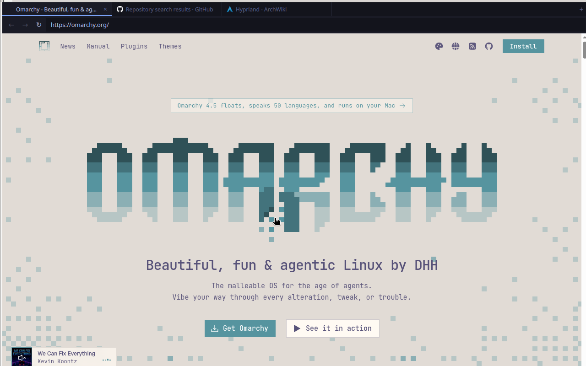
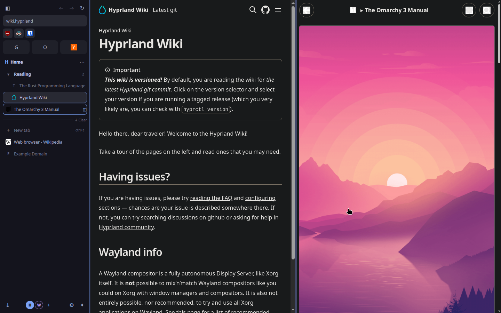
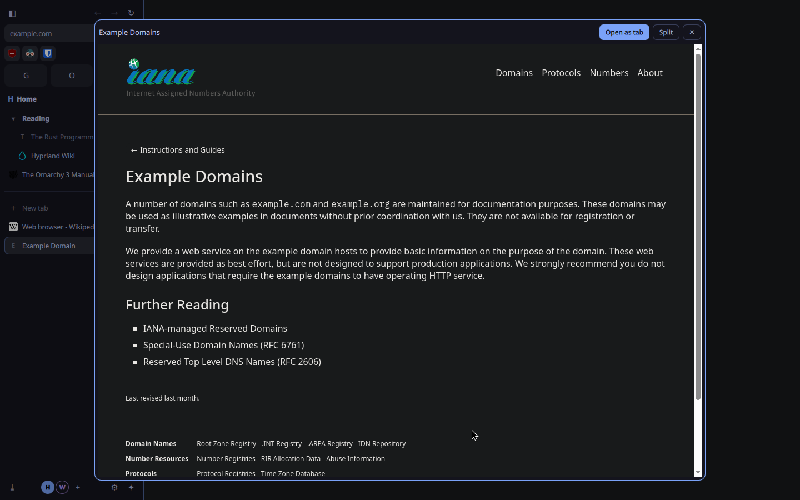
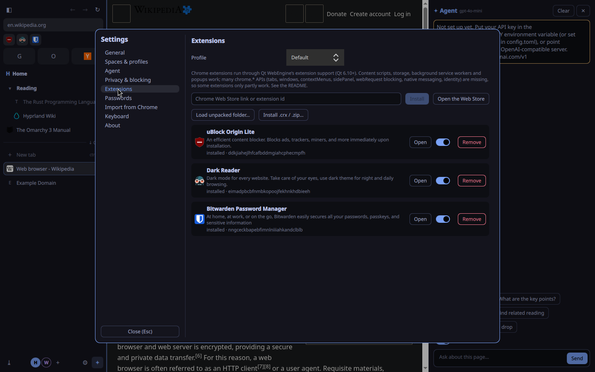
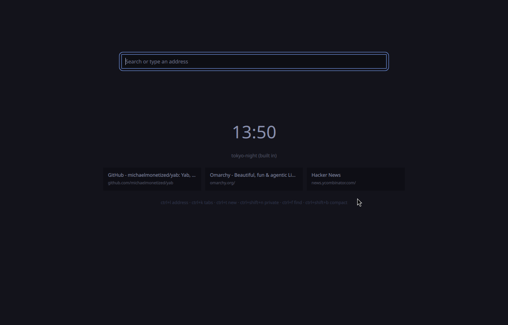

# Qi

A keyboard-first browser for [Omarchy](https://omarchy.org): Rust core, Qt Quick
chrome, Chromium pages through Qt WebEngine, and the active Omarchy theme
everywhere, live.

Qi is a Linux rewrite of [Yab](https://github.com/yetanotherbrowser/yab)
("yet another browser", a native macOS browser by Serafim Korablev). It keeps
Yab's look and idea, nothing in the way: no frame, no title bar, no
toolbar, just the page, edge to edge. Tabs live in a Yab-style sidebar
(back / forward / reload, the address as a quiet pill, New tab, the tab
list) that slides in when the pointer touches the left edge of the window
and hides again when it leaves, or stays pinned beside the page. Addresses
and searches go through one field that appears on demand as a palette
(Ctrl+L, Ctrl+T) and is gone again once you press Return. It does not reuse
Yab's Swift code, names or icons.







## Why this stack

- **Qt Quick (QML), the toolkit Quickshell is built on.** Omarchy's shell
  and most Hyprland bars are QML, so Qi looks and behaves like part of
  the desktop, not a GTK or Electron guest. Quickshell itself is a runtime
  for desktop-shell configs (bars, panels, launchers), not for
  applications: it can load a `WebEngineView` behind a pragma, but only in
  a WebEngine-enabled build, and current releases crash Qt WebEngine on
  start (it builds `QGuiApplication` with `argc = 0`). So Qi is a
  standalone Qt Quick app with the same QML idiom and its own process.
- **Rust core via [cxx-qt](https://github.com/KDAB/cxx-qt).** Theme
  parsing and watching, the address field's logic, history, the workspace
  (spaces, folders, archive), profiles, bookmarks, the blocker's lists,
  the agent's requests, extension downloads, the Chrome importer and
  single-instance IPC are Rust (`src/`, unit-tested); a small C++ object
  (`cpp/webtools.*`) hosts the request interceptor and cookie store; QML
  only draws.
- **Qt WebEngine (Chromium).** Sites work the way they do in Chromium,
  Omarchy's default browser, with DevTools built in.
- **Not egui, not iced, not Rune (yet).** [Rune](https://github.com/anomalyco/rune),
  Anomaly's new GPU-rendered Rust UI framework, was the alternative. It is
  pre-release and has no way to host a web engine: there is no web view or
  external-texture embedding, so a browser would mean compositing Servo or
  WPE frames into it by hand. When Rune can embed a surface, the Rust core
  here can move over unchanged.

## What Omarchy gets

- **The live theme.** Reads `colors.toml` from
  `~/.local/state/omarchy/current/theme` (Omarchy 4) or
  `~/.config/omarchy/current/theme` (Omarchy 3), falling back to the
  theme's `alacritty.toml`, and fills missing keys with the same rules
  `omarchy-theme-color` uses. `omarchy theme set <name>` re-colours the
  sidebar, palette, menus, start page and the page background as it happens
  (inotify on the `current` dirs, plus a 3 s poll as a safety net). Light
  or dark mode goes to Qt's colour-scheme hint and from there to the web's
  `prefers-color-scheme`; open pages pick it up on reload.
- **The Omarchy font.** The fontconfig monospace family that
  `omarchy-font-set` writes, else your Alacritty or Ghostty font.
- **Hyprland-native.** Wayland first, app_id `qi`, a frameless
  window with no client-side decorations, title bar, shadows or margins,
  so it tiles edge to edge and Hyprland's border is the only frame. Super stays
  Hyprland's: every Qi shortcut uses Ctrl or Alt.
- **One instance.** `qi <url>` from a terminal, a bind or `xdg-open`
  opens a tab in the running window (a Unix socket in `$XDG_RUNTIME_DIR`).
- **Omarchy's browser binds.** Make Qi the default browser
  (`make default-browser`) and Omarchy's browser key opens it; `--private`,
  `--incognito` and `--private-window` all open a private tab, so the
  private-browser bind works too.
- **Mako notifications** for finished and failed downloads, through
  `notify-send`.
- **XDG paths.** Config `~/.config/qi/config.toml`
  ([example](config.example.toml)); profiles, history, bookmarks,
  extensions and hidden elements in `~/.local/share/qi`; the workspace
  (spaces, folders, tabs, archive, watches) in
  `~/.local/state/qi/workspace.json`; filter lists in `~/.cache/qi`.

## What works

- **Chromeless by default.** The page fills the window. The sidebar is
  hidden until the pointer reaches the left edge (or Ctrl+Shift+B), hides
  when the pointer leaves, and can be pinned open. `tabs = "top"` brings
  back a classic tab strip and address bar.
- **Yab's sidebar.** Window controls and back / forward / reload, the
  address as a pill (with the count of blocked requests and a bookmark
  star), extension buttons, **favorites** as tiles at the top (the same in
  every space), the space's name, its **folders** and **pinned tabs**, New
  tab, then **today's tabs**. Drag tabs into and out of folders, onto
  favorites, between pinned and today, or onto another space's icon.
  Right-click a tab, folder or space for everything else.
- **Spaces.** Separate sets of tabs, each with a colour taken from the
  Omarchy theme (accent, blue, magenta, …) so it follows theme swaps.
  Switch from the footer, Ctrl+Alt+1…9, Ctrl+Alt+Left/Right, or a
  two-finger swipe over the sidebar. Each space opens its tabs in one
  **profile**, like Arc.
- **Auto-archive.** Today's tabs nobody touched for `archive_after_hours`
  (12 by default, 0 = never) move to the archive (Ctrl+Alt+A), where they
  can be restored. Pinned tabs, favorites and the current tab never do.
  Pinned tabs keep their pinned address ("Back to pinned address").
- **Footer.** Downloads (with an active-count badge), the space icons,
  new space, settings and the agent.
- **Settings** (Ctrl+,): every key of `config.toml` worth flipping, spaces
  and profiles, the agent, blocking, extensions, passwords, the Chrome
  importer and the keyboard. Writes keep your file's comments, and hand
  edits to `config.toml` apply live too.
- **Library**: bookmarks (Ctrl+Shift+D adds one, Ctrl+Alt+B lists them),
  history (Ctrl+H), downloads (Ctrl+Shift+J) and the archive, per profile.
- **Agent panel** (Ctrl+Shift+A), see below.
- **Split view** (Ctrl+Alt+S): the current tab beside the next one, or any
  tab from its menu; drag the divider, double-click it to unsplit.
- **Peek**: links that ask for a new window, and pop-ups, open in a card
  over the page; open it as a tab, split with it, or Esc. `peek = false`
  sends them to tabs.
- **Ad and tracker blocking** inside the engine (a
  `QWebEngineUrlRequestInterceptor`), before requests are made, from host
  lists and the `||domain^` rules of adblock lists (`[blocker] lists`,
  refreshed weekly into `~/.cache/qi`), plus a built-in list. Per-site
  allow list and blocked counts in site controls (Ctrl+E).
- **Hide something** (Ctrl+Shift+H): click any element and it stays
  hidden on that site; site controls bring it back.
- **Reading mode** (Ctrl+Alt+R): the article alone, in the theme's colours.
- **Passwords in your keyring.** Qi offers to save a password when you
  sign in and fills it (Ctrl+Alt+L). Passwords live only in the Secret
  Service (`secret-tool`, so GNOME Keyring or KWallet); Qi's files only
  hold which sites have one.
- **Dark pages** (`force_dark = true`), lazy tabs (restored tabs cost
  nothing until shown), find in page, zoom, full screen, view source,
  DevTools, private tabs, session restore, reopen-closed-tab, permission
  prompts, downloads with Mako notifications.

## Profiles

Each profile is a separate persistent Qt WebEngine profile: its own
cookies, local storage, cache, history, bookmarks, saved-password index and
extensions.

- `Default` keeps the original storage (`~/.local/share/qi/qi/QtWebEngine/qi`),
  so existing sign-ins survive the upgrade. Others live in
  `~/.local/share/qi/profiles/<name>/` (cache in `~/.cache/qi/profiles/<name>`).
- Add, remove and pick the default in Settings → Spaces & profiles; bind
  any space to a profile there or from the space's menu.
- `qi --profile Work https://…` opens in the space bound to `Work`
  (creating the profile and a space for it if needed), also when Qi is
  already running. `--profile-directory` is accepted for Chrome-style
  launchers.

**Import from Chrome** (Settings → Import from Chrome) finds Google Chrome
(stable, beta, dev), Chromium, Brave, Edge and Vivaldi profiles in
`~/.config` by the names in their `Local State`, or any profile folder you
point it at (for Chrome run with `--user-data-dir`), and imports into the
Qi profile you choose:

| What | How | Can't come across |
| --- | --- | --- |
| Bookmarks | `Bookmarks` JSON, folders kept under "Imported (…)" | — |
| History | `History` SQLite | visit-by-visit detail beyond counts and last visit |
| Cookies (stay signed in) | `Cookies` SQLite, decrypted (AES-128-CBC, v10 with Chrome's built-in key, v11 with the keyring password read by `secret-tool`), written straight into the web engine's cookie store | v11 cookies when the keyring can't be read; app-bound or device-bound session cookies |
| Passwords | `Login Data`, decrypted the same way, saved into the Secret Service under Qi's entries | everything when `secret-tool` isn't installed (they are decrypted in memory, then dropped, and the report says so) |
| Extensions | copied from `Extensions/<id>/<version>` and installed into the profile | see Extensions below for what runs |

Open tabs, payment cards, autofill addresses, site settings and Chrome
sync never come across. Databases are copied to a temporary directory
before reading, so Chrome may stay open, but close it for a consistent
snapshot. Nothing decrypted is written to Qi's files.

## Extensions

Qi uses Qt WebEngine's extension support (Qt 6.10+,
`QWebEngineExtensionManager`), per profile:

- Install from the **Chrome Web Store**: an "Add to Qi" button appears
  on store pages, or paste a store link or id in Settings → Extensions.
  Qi downloads the CRX for Chromium 140 (Qt 6.11's), unpacks it, keeps
  its signing key so the extension has its store id, and installs it.
- Load an **unpacked** folder (remembered across restarts) or install a
  **.crx / .zip** file.
- Enable, disable (remembered; Qt doesn't keep it) and remove; toolbar
  buttons in the sidebar open the extension's popup.

**What actually works, tested on Qt 6.11.3 / Chromium 140 (Nov 2026):**

| Extension | Installs | Popup | Does its job | Why not |
| --- | --- | --- | --- | --- |
| uBlock Origin Lite | yes, store id kept | draws, no stats | **no**: requests it should block go through | its service worker dies at `chrome.tabs.onRemoved` (no `chrome.tabs`), so it never enables its rulesets |
| Dark Reader | yes | stuck on "Loading, please wait" | **partly**: pages turn dark with its defaults | its background stops at an `addListener` on an API Qt doesn't provide, so the popup never gets an answer: no per-site toggles or settings |
| Bitwarden | yes | spinner forever | **no** | its background hits missing APIs (`onClicked` of an undefined namespace) and the popup's messages go unanswered |

Qt WebEngine implements only a slice of the extension platform (manifest
loading, content scripts, basic `runtime` messaging, `storage`, action
popups as pages an embedder can show). It has no `chrome.tabs`,
`chrome.windows`, `contextMenus`, `sidePanel`, `commands`, `identity`,
blocking `webRequest`, native messaging, or a toolbar-click (action
`onClicked`) path an embedder can drive. Almost every real extension
touches these on start, so **Chrome extension parity is not
possible on Qt WebEngine today**; simple content-script extensions are the
ceiling. Qi's own blocker, passwords and hide-element cover the most
common reasons people install extensions on this build.

### Qi (CEF)

Qi (CEF) is the other build. It is a CEF Views window on the Chrome
runtime with Chrome-style browsers, so the real extension system is there:
`chrome.tabs`, action popups, the Web Store, native messaging lookups.
It opens your actual Chromium, Chrome or Brave profile, after a backup,
and refuses to start when that browser still holds the profile lock.
The backup does not stop Qi from changing the live profile: extension
developer mode is turned on, and Chrome sync metadata is cleared.
`--snapshot` opens a copy instead. That copy can miss writes if the
browser is still saving. Chromium keeps its cookies and logins. Chrome
and Brave open logged out until their safe-storage keys are mapped.
LastPass's toolbar icon and popup work on Chromium. The Qt window and
this one stay separate: embedding a CEF browser inside Qt on Wayland is
unsupported upstream. What is still missing (sidebar, split, agent, and
the rest) is [docs/cef-roadmap.md](docs/cef-roadmap.md).

From `omarchy/`:

```bash
cd cef && ./fetch-cef.sh
cmake -S . -B build -DCMAKE_BUILD_TYPE=Release
cmake --build build -j"$(nproc)"
cd .. && make install-cef          # ~/.local/bin/qi-cef, launcher "Qi (CEF)"
qi-cef                             # or: qi-cef --list-profiles
```

Shells started from an AppImage should unset `LD_LIBRARY_PATH`, `APPDIR`,
`APPIMAGE` and `OWD` first. The `qi-cef` wrapper does that. Keep the CEF
milestone equal to the Chromium you already run, or the next Chromium
start will see a profile upgrade. Nothing here is published to the AUR.

## Agent

A chat panel on the right (Ctrl+Shift+A, or ✦ in the sidebar footer) that
reads the current tab (title, address, selected text and visible text, up
to `agent.max_page_chars`) and can summarize, answer, and act:
open an address, search the web, click a link or button, type into a
field (and submit), scroll, find in page, and **watch** a tab ("tell me
when this drops under $200": it re-reads the tab every N minutes and
notifies you when the condition holds). Clicking and typing ask first
unless `agent.confirm_actions = false`. Private tabs are never read or
sent, and page text is marked as untrusted for the model.

It speaks the OpenAI chat-completions API (streaming, tool calls), so any
compatible server works: OpenAI, OpenRouter, Groq, or a local Ollama /
llama.cpp / LM Studio (local endpoints need no key).

```toml
[agent]
endpoint = "https://api.openai.com/v1"
model = "gpt-4o-mini"
api_key_env = "QI_AGENT_API_KEY"   # read from the environment
# api_key_command = "secret-tool lookup service openai"
```

The key comes from the environment variable named by `api_key_env`
(default `QI_AGENT_API_KEY`, then the pre-rename `OMAWEB_AGENT_API_KEY`,
then `OPENAI_API_KEY`), else from `api_key_command`'s output, else
`agent.api_key` in your config. The settings screen never asks for or
writes the key.

## Keys

Ctrl and Alt only; Super stays Hyprland's.

| Keys | Does |
| --- | --- |
| Ctrl+L, Alt+D, F6 | Address palette (Esc closes it) |
| Ctrl+K | Jump to any open tab, in any space |
| Ctrl+T / Ctrl+Shift+N | New tab / new private tab |
| Ctrl+Shift+B, Ctrl+S | Show and pin / hide the sidebar (`tabs = "top"`: compact mode) |
| Pointer at the left edge | Reveal the sidebar; it hides when the pointer leaves |
| Ctrl+W | Close tab (pinned tabs and favorites unload instead) |
| Ctrl+Shift+T | Reopen closed tab |
| Ctrl+Tab, Ctrl+PgDown / Ctrl+Shift+Tab, Ctrl+PgUp | Next / previous tab |
| Ctrl+Shift+PgDown / PgUp | Move tab down / up |
| Ctrl+1 … Ctrl+8, Ctrl+9 (also Alt+n) | Tab n (favorites first), last tab |
| Ctrl+Alt+1 … 9 | Space n |
| Ctrl+Alt+Right / Left | Next / previous space |
| Ctrl+Alt+N | New space |
| Ctrl+D | Pin / unpin tab |
| Ctrl+Shift+D | Bookmark / unbookmark page |
| Ctrl+Alt+B / Ctrl+H, Ctrl+Y / Ctrl+Shift+J, Ctrl+J / Ctrl+Alt+A | Bookmarks / history / downloads / archive |
| Ctrl+Shift+A | Agent panel |
| Ctrl+Alt+S | Split with the next tab (again to unsplit) |
| Ctrl+Alt+R | Reading mode |
| Ctrl+Shift+H | Hide something on this site |
| Ctrl+E | Site controls (blocking, hidden elements, cookies) |
| Ctrl+Alt+L | Fill the saved password |
| Ctrl+Shift+V | Paste and go |
| Ctrl+, | Settings |
| Alt+Left / Alt+Right | Back / forward |
| Ctrl+R, F5 / Ctrl+Shift+R | Reload / reload without cache |
| Esc | Stop loading; close Peek, the library or settings |
| Ctrl+F, then Enter / Shift+Enter, Ctrl+G | Find, next, previous |
| Ctrl+= / Ctrl+- / Ctrl+0 | Zoom in / out / reset |
| F11 | Full screen |
| Ctrl+U | View source |
| F12, Ctrl+Shift+I | DevTools |
| Ctrl+Shift+C | Copy page address |
| Ctrl+Q | Quit (everything is saved) |

In the address palette, Up/Down or Ctrl+N/Ctrl+P pick a suggestion.
Shift+click a link (or any pop-up) to Peek at it.

## Build and run

On Omarchy / Arch:

Omarchy already ships Rust and Qt 6. Leave `qt6-webengine` alone: installing
it again downgrades the package.

```bash
cd omarchy
make install           # builds release, installs qi to ~/.local
qi                     # or: make default-browser
```

`make install` also leaves `omaweb` as a symlink to `qi` and removes the
old Omaweb launcher. If Omaweb was the default browser, the default becomes
Qi. The CEF build is separate: [Qi (CEF)](#qi-cef) above, `make install-cef`.

Optional: [`data/hyprland.conf`](data/hyprland.conf) has a bind and a window
rule to copy into your Hyprland config; pick a key Omarchy isn't using.

cxx-qt finds Qt through `qmake6`/`qmake` on `PATH`, or `QMAKE=/path/to/qmake`.
`cargo test` runs the Rust tests (theme, address field, history, session,
config, workspace, bookmarks, blocker, agent, extensions, Chrome import,
passwords, profiles). `QI_CHROME_TEST_PROFILE=/tmp/x/Default cargo test -- --ignored`
also runs the importer against a throwaway Chrome profile. `qi --theme` prints the palette it would use.

Environment overrides: `QI_THEME_DIR` (read a theme dir directly),
`QI_FONT`. The old `OMAWEB_THEME_DIR`, `OMAWEB_FONT` and
`OMAWEB_AGENT_API_KEY` still work. Qi sets `QT_WAYLAND_DISABLE_WINDOWDECORATION=1`,
`QT_QPA_PLATFORMTHEME=gtk3` and the Basic Quick Controls style unless you
set them yourself.

## Not here yet

- **Chrome extensions on the Qt build.** Qi (CEF) runs them. The sidebar,
  Spaces and the agent are not on that build yet; see
  [docs/cef-roadmap.md](docs/cef-roadmap.md).
- Yab's floating video (picture-in-picture: Qt WebEngine has no PiP),
  end-to-end encrypted sync, agents in their own tabs with your sign-ins
  (Qi's agent is a side panel acting on the current tab), and Yab's
  iPhone and Android companions (still in the upstream tree, untouched).
- Hooking into third-party password managers (1Password, Bitwarden apps);
  Qi uses the Secret Service.
- Packaging. Nothing is published to the AUR.

## Credit and license

Qi is derived from Yab, © 2026 Serafim Korablev, Apache License 2.0
(itself a fork of Search by Office Commun, MIT). "Yab", "Yet Another
Browser" and Yab's icons are Serafim Korablev's trademarks and are not used
for this app; see [TRADEMARKS.md](../TRADEMARKS.md). Qi's own code is
under the same Apache License 2.0 ([LICENSE](../LICENSE), [NOTICE](../NOTICE)).
Built with Qt (LGPLv3), Qt WebEngine / Chromium, cxx-qt (MIT or Apache-2.0)
and the crates in `Cargo.lock`.
